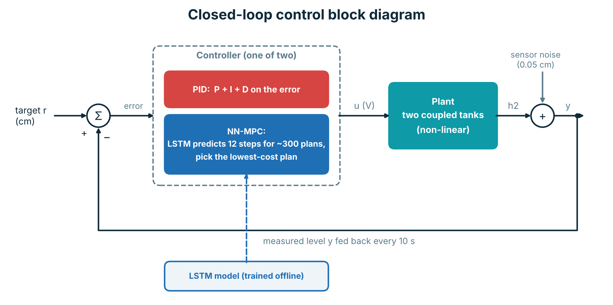
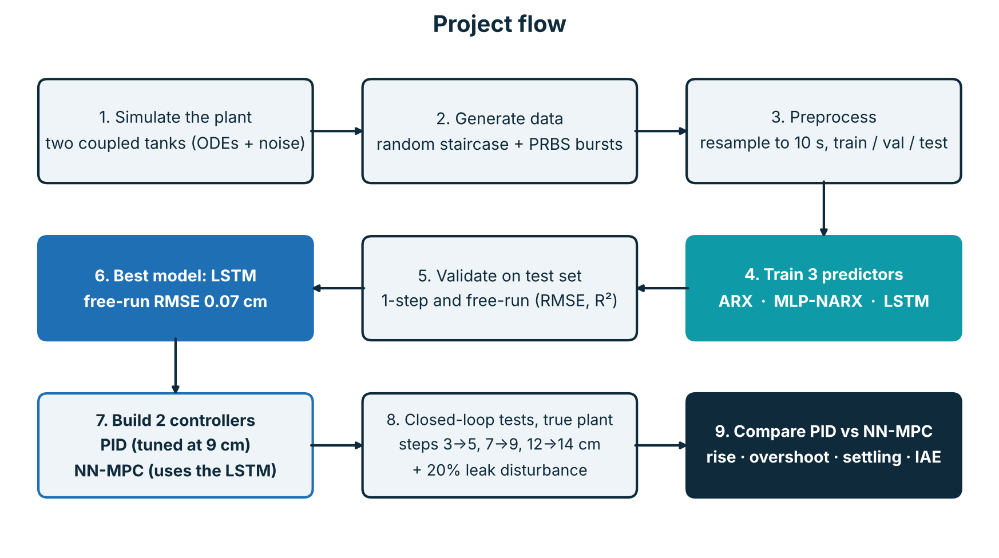

# Neural Network Control of a Coupled-Tank System (LSTM-based MPC vs PID)

A Neural Networks and Deep Learning (NNDL) course project that compares a classic **PID controller** with a **neural-network Model Predictive Controller (NN-MPC)** on a simulated two-tank water system.

## What is this about?

Picture two water tanks stacked so that the top one drains into the bottom one, which also has a small leak. A pump fills the top tank. **The goal is to keep the water in the bottom tank at a chosen height** (e.g. 9 cm), even when the target changes or the leak gets bigger.

The twist is that this system is **non-linear**: it reacts differently at low and high water levels. A PID controller tuned for one level can struggle at others. This project tests whether a neural network that has learned the whole system can do better.

### What the notebook does

1. **Simulates the plant**: a two-tank system with sensor noise (physics ODEs solved with `scipy`).
2. **Shows the non-linearity** (Experiment 1): step responses at low vs high levels.
3. **Generates a dataset** (Experiment 2): random staircase and PRBS-style pump inputs, split into train / validation / test.
4. **Trains three models** to predict the next water level:
   - **Linear ARX**: baseline straight-line model
   - **MLP-NARX**: feed-forward neural network (2 × 32 tanh) via scikit-learn
   - **LSTM**: implemented **from scratch in NumPy**, with backpropagation through time and the Adam optimizer
5. **Validates the models** (Experiment 4): 1-step and free-run prediction, scored with RMSE and R², also broken down by water level.
6. **Builds two controllers** (Experiments 5-7):
   - **PID**: gains tuned with Nelder-Mead on the plant linearised at 9 cm
   - **NN-MPC**: uses the trained LSTM to predict 12 steps ahead, tries about 300 candidate pump plans each step, and applies the best first move
7. **Compares them in closed loop** on the true plant: step changes at low/medium/high levels (3→5, 7→9, 12→14 cm) and a +20% leak disturbance. Metrics: rise time, overshoot, settling time, IAE.

## Project structure

```
.
├── nndl_project.ipynb   # the full project (run this)
├── requirements.txt     # Python dependencies
├── .gitignore
└── README.md
```

## How to run

### 1. Prerequisites
- Python 3.9 or newer
- `git`

### 2. Clone the repository
```bash
git clone https://github.com/<your-username>/<your-repo-name>.git
cd <your-repo-name>
```

### 3. (Recommended) Create a virtual environment
```bash
python -m venv venv

# Linux / macOS
source venv/bin/activate

# Windows
venv\Scripts\activate
```

### 4. Install dependencies
```bash
pip install -r requirements.txt
```

### 5. Open and run the notebook
```bash
jupyter notebook nndl_project.ipynb
```
Then choose **Kernel → Restart & Run All** (or run the cells top to bottom).

Alternatively, run it headless and save the executed copy:
```bash
jupyter nbconvert --to notebook --execute nndl_project.ipynb --output executed.ipynb
```

> **Note:** Run the cells **in order**, since later cells depend on earlier ones. Training the MLP (2500 epochs) and the NumPy LSTM (250 epochs) and the MPC simulations can take several minutes, depending on your machine.

## Outputs

Running the notebook prints metric tables and saves these figures in the working directory:

| File | Shows |
|---|---|
| `exp1_nonlinearity.png` | Step responses at low vs high water levels |
| `exp2_dataset.png` | Input voltage, output level, and input histogram |
| `exp3_loss_curves.png` | Training/validation loss for MLP and LSTM |
| `exp4_freerun.png` | Free-run predictions vs measured data |
| `exp7_control.png` | PID vs NN-MPC step and disturbance responses |

## Block Diragrams

### Closed-Loop Control System



### Project flow




## Tech stack
Python, NumPy, SciPy, scikit-learn, Matplotlib, Jupyter

## Author
Pardha Saradhi


